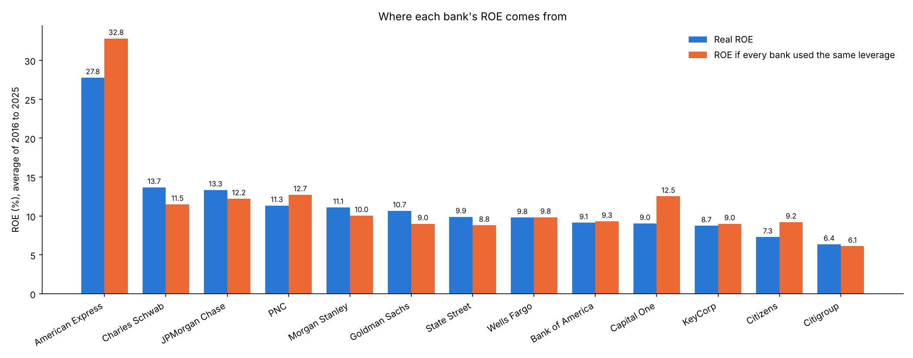
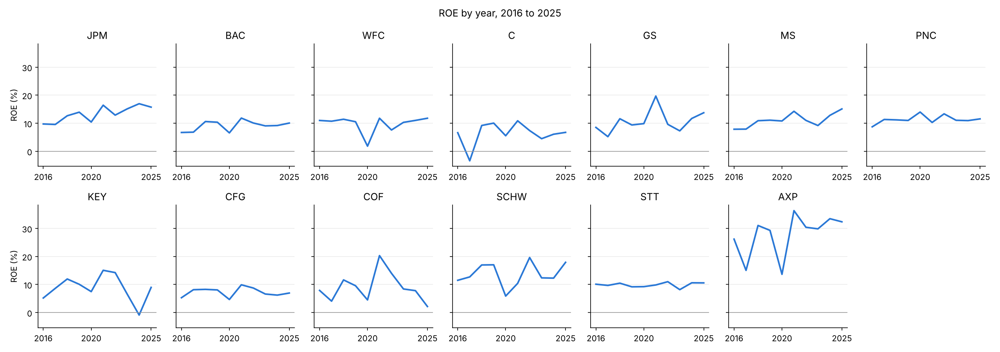

# Bank Financial Ratio Analysis

## At a glance

- **Question:** which big US banks earn their returns by running the business well, and which get them by borrowing more?
- **Data:** annual reports of 13 large US banks, 2016 to 2025, pulled from the SEC with code.
- **Method:** ratios, rankings and year-over-year change calculated in SQL. ROE is split into its two parts: profit earned on assets (ROA) and leverage.
- **Finding:** the usual ranking by ROE misleads. Capital One ranks 10th of 13 on ROE, but 3rd once every bank is given the same leverage. Goldman Sachs drops from 6th to 10th.

## Why this question

Banks are usually compared on one number, ROE (return on equity). But a bank can raise its ROE in two ways: earn more profit from what it owns, or borrow more. The second way adds risk. An investor or a credit analyst needs to know which one they are looking at.

I started this project comparing three banks to understand how bank ratios work. The most interesting thing I noticed was that two banks can show a similar ROE and get there in different ways. So I rebuilt the project around that one question, with 13 banks and 10 years.

## How to read the numbers

| Ratio | Formula | In plain words |
|---|---|---|
| ROE | Profit / Shareholders' money | What the owners earn on what they put in |
| ROA | Profit / Total assets | How well the bank uses everything it owns |
| Leverage | Total assets / Shareholders' money | 12 means 12 dollars of assets for every 1 dollar of the bank's own money |
| Efficiency ratio | Costs / Revenue | What the bank spends to earn 1 dollar. Lower is better |
| NIM | Net interest income / Total assets | What the bank earns from lending (simplified) |

**ROE = ROA x Leverage.** This is the key idea, a standard method called DuPont analysis. It lets you see how much of a bank's ROE comes from the business and how much from leverage.

## What I did

**1. Pulled the data with code.** Six numbers for each bank and year come straight from the SEC's public data service: 13 banks x 10 years x 6 numbers = 780 values, none missing. One thing I had to handle: banks do not all use the same tag for the same number (revenue is `Revenues` or `RevenuesNetOfInterestExpense`), so the code tries a short list of tags. I checked JPMorgan's 2025 numbers against its filing.

**2. Loaded it into SQL (DuckDB) as two tables:** `financials` (one row per bank, year and number) and `banks` (name and type of each bank).

**3. Did the analysis in SQL.** The queries are in the notebook and also in [`queries.sql`](queries.sql):

| Query | What it answers | SQL used |
|---|---|---|
| 1 | One row per bank and year | `JOIN`, `CASE WHEN`, `GROUP BY` |
| 2 | The five ratios | calculated columns, a view |
| 3 | ROE rank in each year | `RANK() OVER (PARTITION BY ...)` |
| 4 | Change in ROE from the year before | `LAG()` |
| 5 | Where each bank's ROE comes from | CTEs (`WITH`), `MEDIAN`, `CROSS JOIN`, `RANK()` |
| 6 | Costs and lending margin by bank type | `GROUP BY` on the joined tables |

## Results

Ten-year averages, 2016 to 2025:

| Bank | Type | ROE | ROA | Leverage | ROE at typical leverage | Rank by ROE | Rank at typical leverage |
|---|---|---|---|---|---|---|---|
| American Express | Card lender | 27.77% | 3.17% | 8.80 | 32.81% | 1 | 1 |
| Charles Schwab | Brokerage and custody | 13.67% | 1.11% | 12.32 | 11.49% | 2 | 5 |
| JPMorgan Chase | Universal bank | 13.34% | 1.18% | 11.32 | 12.21% | 3 | 4 |
| PNC | Regional bank | 11.34% | 1.23% | 9.39 | 12.73% | 4 | 2 |
| Morgan Stanley | Investment bank | 11.09% | 0.97% | 11.38 | 10.04% | 5 | 6 |
| Goldman Sachs | Investment bank | 10.66% | 0.87% | 12.24 | 9.00% | 6 | 10 |
| State Street | Brokerage and custody | 9.89% | 0.85% | 11.72 | 8.80% | 7 | 12 |
| Wells Fargo | Universal bank | 9.80% | 0.95% | 10.35 | 9.83% | 8 | 7 |
| Bank of America | Universal bank | 9.13% | 0.90% | 10.14 | 9.31% | 9 | 8 |
| Capital One | Card lender | 9.04% | 1.21% | 7.39 | 12.52% | 10 | 3 |
| KeyCorp | Regional bank | 8.74% | 0.87% | 10.21 | 9.00% | 11 | 10 |
| Citizens | Regional bank | 7.29% | 0.89% | 8.27 | 9.21% | 12 | 9 |
| Citigroup | Universal bank | 6.36% | 0.59% | 10.72 | 6.11% | 13 | 13 |

"ROE at typical leverage" is what each bank's ROE would be if it used the leverage of the middle bank in the group (10.35). The last column ranks the banks on that number.

**1. Capital One looks much worse than it is.** 10th of 13 on ROE (9.0%), but 3rd once leverage is made equal. It earns more on its assets than almost any other bank (ROA 1.21%) and borrows the least (leverage 7.4).

**2. The three banks that borrow the most all drop.** Charles Schwab falls from 2nd to 5th, Goldman Sachs from 6th to 10th, and State Street from 7th to 12th. Their ROE is lifted by leverage of about 12.

**3. JPMorgan's ROE is mostly earned.** It moves only from 3rd to 4th.

**4. American Express is first either way.** Its ROE (27.8%) and ROA (3.17%) are far above every other bank. It earns fees on card spending, which needs few assets, so it is a different kind of business and not a fair yardstick for the others.

**5. Citigroup is last either way.** Its leverage is typical, so the weakness is in the business itself.

**6. Bank types work differently.** Card lenders earn 5.2% on lending (NIM), regional banks 2.5%, universal banks 2.1%, and investment banks 0.5%. NIM should only be compared between banks of the same type.

**What this means:** ranking by ROE alone puts Goldman Sachs four places above Capital One. With leverage made equal, Capital One is seven places above Goldman Sachs.

## Limits

- Ratios use year-end balance sheet numbers, not averages over the year.
- NIM is simplified (divided by total assets, where banks normally use interest-earning assets).
- Higher leverage does not mean the same risk at every bank. Charles Schwab and State Street mostly hold client cash in safe assets. A card lender takes more credit risk, so it has to hold more of its own money.
- PNC reports profit under a slightly different tag (`ProfitLoss`), which includes a small share belonging to outside partners.
- 2025 was unusual for Capital One: it bought Discover that year, which roughly doubled its equity and pulled its ROE down to 2.2%.
- Leverage here is a simple accounting measure. Regulators use risk-weighted capital ratios such as CET1, which are not in these data.

## Files

- `Bank.ipynb`: the full notebook (data pull, SQL analysis, charts, conclusion)
- `queries.sql`: the six SQL queries on their own
- `bank_financials.csv`: the numbers pulled from the SEC
- `bank_ratios.csv`: the five ratios for every bank and year
- `roe_breakdown.csv`: the final table shown above
- `roe_breakdown.png`, `roe_by_year.png`: the charts
- `requirements.txt`: the Python packages needed

## How to run this yourself

1. Clone this repo and run `pip install -r requirements.txt`.
2. Open `Bank.ipynb`. In Part 1, put your own name and email in the `headers` line (the SEC asks every program to say who is calling).
3. Run all cells from top to bottom. Part 1 needs internet access. If you skip it, the saved `bank_financials.csv` lets Parts 2 to 4 run on their own.

## Tools

SQL (DuckDB), Python (pandas, requests, matplotlib), SEC EDGAR data.

## About me

Rahul Kulkarni
M.S. Business Analytics, UC San Diego (Rady School of Management)
