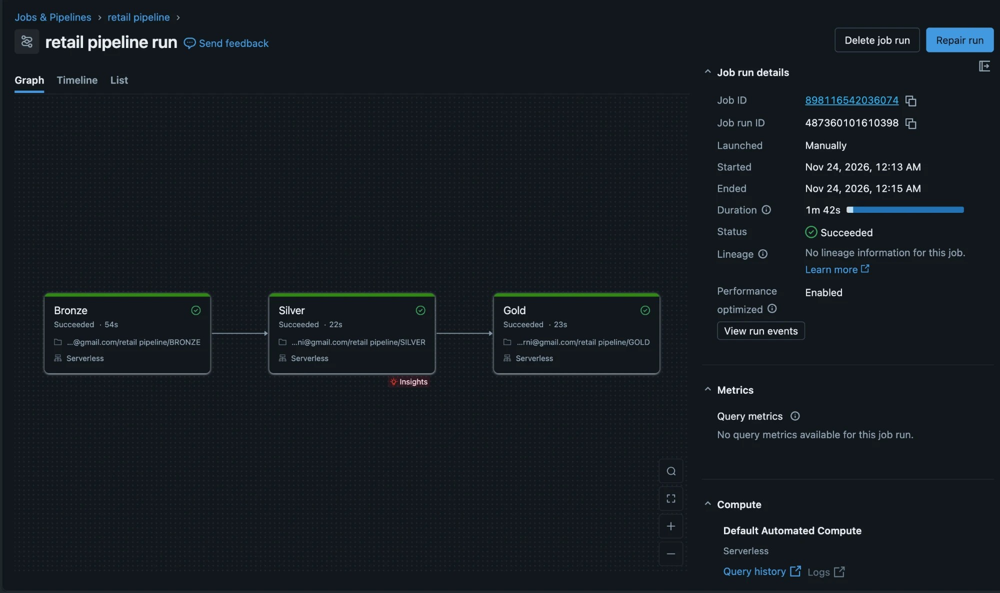

# Snowflake to Databricks Medallion Pipeline

## At a glance

- **What it does:** moves 1,067,371 raw retail transactions from Snowflake into Databricks, cleans them in SQL, and builds the summary tables behind my sales dashboard.
- **Layers:** Bronze (raw copy), Silver (checked and cleaned), Gold (summary tables).
- **Result:** 804,824 valid rows kept and 262,547 rejected, each with a recorded reason. The row counts add up exactly across the layers.
- **Checked against Python:** the SQL pipeline gives the same rows, customers, orders and revenue as my earlier cleaning in pandas.
- **Runs as a job:** three tasks in order, finishing in under two minutes.



## Why I built it

My [Retail Sales Performance Dashboard](https://github.com/Rahulkulkarni2002/retail-sales-performance-dashboard) was built from a file cleaned in pandas on my laptop. That works once, but a real team needs the data to come from a database, be cleaned the same way every time, and be ready for reporting without anyone running a script by hand. This project does that for the same data.

It began as an exercise in an online course, on a 600-row practice table in the instructor's Snowflake account. I rebuilt it from scratch on my own Snowflake and Databricks accounts with real data, and added the quality checks, the rejected-rows table and the Gold summary tables.

## How the data flows

```
Snowflake (RETAIL_DB.RAW.ONLINE_RETAIL_RAW, 1,067,371 rows)
        |
        v
BRONZE   raw copy, every column kept as text        1,067,371 rows
        |
        v
SILVER   valid rows, with proper types                804,824 rows
         rejected rows, with the reason               262,547 rows
        |
        v
GOLD     revenue by month                                  25 rows
         sales by product                               5,277 rows
         sales by country                                  41 rows
```

## What each layer does

### Snowflake (the source)

I created the database, schema and table in SQL and loaded the raw file into it. All columns are text on purpose, so the source holds the data exactly as it arrived.

### Bronze

- Reads the table from Snowflake with the Spark Snowflake connector (PySpark).
- Makes the column names lowercase and adds a `loaded_at` column recording when the data was loaded.
- Saves it as a Delta table. Nothing is cleaned here.

### Silver

Every row is labelled valid or rejected, in SQL:

| Reason a row is rejected | Rows |
|---|---|
| Missing customer ID | 243,007 |
| Cancelled order (invoice starts with C) | 18,744 |
| Non-product code (manual adjustments, bank charges and similar) | 796 |
| **Total rejected** | **262,547** |

- Valid rows are saved with proper types (whole numbers, decimals, timestamps) and a `line_amount` column (quantity x price).
- Rejected rows are saved in their own table with the reason, so nothing disappears without a record.

### Gold

Three summary tables, built in SQL:

| Table | What it holds | SQL used |
|---|---|---|
| `gold_monthly_revenue` | Revenue, orders, customers and average order value per month, with growth from the month before | CTE, `LAG` |
| `gold_product_sales` | Revenue and units per product, ranked both ways | CTE, `RANK` |
| `gold_country_sales` | Revenue, customers and orders per country, with each country's share of revenue | `SUM(...) OVER ()` |

## Checks built into the pipeline

**1. The row counts add up.**

| Bronze rows | Silver rows | Rejected rows | Match |
|---|---|---|---|
| 1,067,371 | 804,824 | 262,547 | true |

**2. No value failed to convert.** Quantity, price and date were converted from text with `try_cast`. The check counts any that failed: 0, 0 and 0.

**3. The result matches my pandas cleaning.**

| | SQL pipeline | pandas (earlier project) |
|---|---|---|
| Rows | 804,824 | 804,824 |
| Customers | 5,855 | 5,855 |
| Orders | 36,718 | 36,718 |
| Revenue | £17,586,462.20 | £17,586,462.20 |

**4. Known issue left visible.** 62 valid rows have a price of zero (free items). They add no revenue, so they are kept, and the check counts them so they are not hidden.

## Orchestration

The pipeline runs as a Databricks Job with three tasks: Bronze, then Silver, then Gold. Each task starts only after the one before it has succeeded, so Silver never runs on a half-loaded Bronze table. The run in the screenshot above took 1 minute 42 seconds on serverless compute (Bronze 54s, Silver 22s, Gold 23s).

## Handling credentials

- Databricks logs in to Snowflake with a key pair, not a password. The public key is registered on the Snowflake user and the private key never leaves the Databricks secret store.
- The Snowflake address, user and private key are all read from a Databricks secret scope at run time:

```python
sf_url = dbutils.secrets.get(scope="my-snowflake", key="url")
sf_user = dbutils.secrets.get(scope="my-snowflake", key="user")
sf_key = dbutils.secrets.get(scope="my-snowflake", key="private-key")
```

No login details appear in the notebooks or in this repository.

## Limits

- This is a batch pipeline that reloads everything on each run. A production version would load only new rows.
- It ran on free trial accounts (Snowflake trial, Databricks Free Edition), so it is not scheduled to run daily.
- The results are shown in this README. The notebooks here are the code without saved outputs.

## Files

- `BRONZE.ipynb`: load from Snowflake into a Delta table
- `SILVER.ipynb`: label, clean and type the rows, with three checks
- `GOLD.ipynb`: the three summary tables and a final row-count check
- `orchestration_job.jpeg`: screenshot of a successful job run

## Data

[Online Retail II](https://www.kaggle.com/datasets/mashlyn/online-retail-ii-uci): sales of a UK online gift-ware retailer, December 2009 to December 2011.

## Tools

Snowflake, Databricks (Spark SQL, PySpark, Delta Lake, Unity Catalog, Jobs), SQL.
