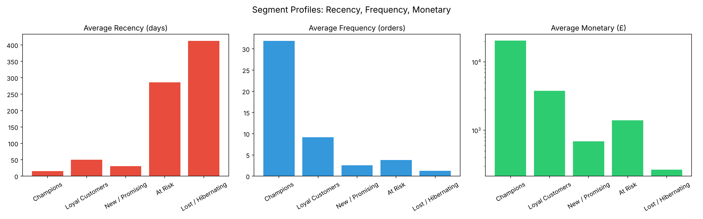
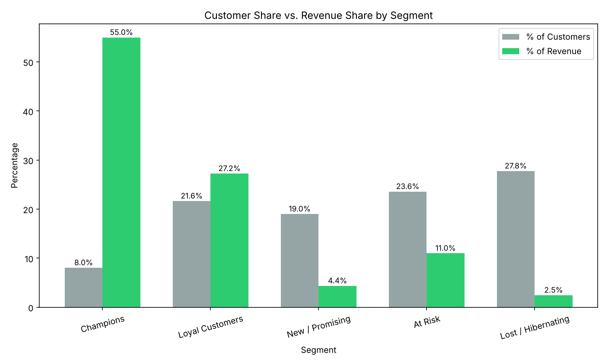
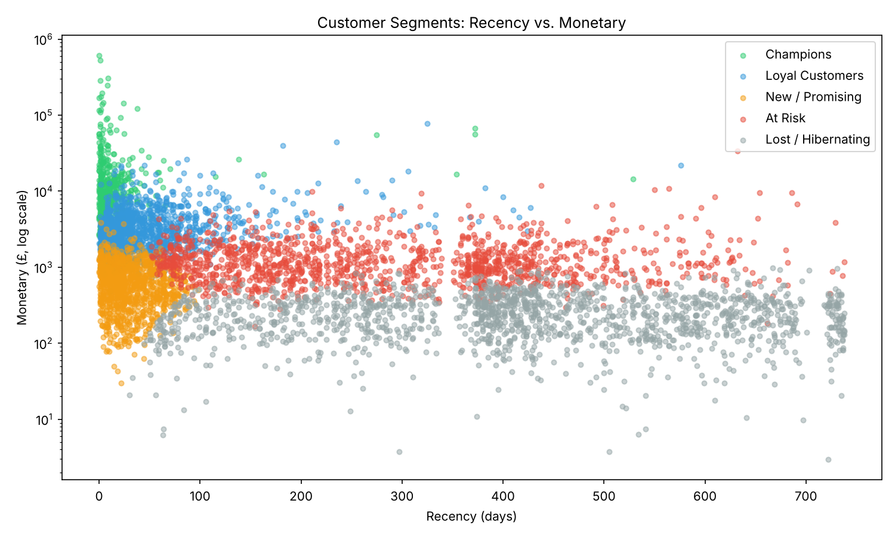
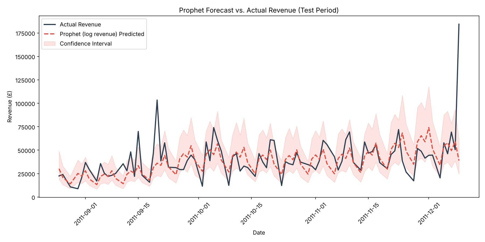

# Customer Segmentation & Revenue Forecasting

## At a glance

- **8.0% of customers (the Champions segment, 471 of 5,855) bring in 55.0% of revenue.**
- Customers are grouped into 5 segments, each with a recommended action.
- K-means was checked against two other clustering methods and scored best.
- A daily revenue forecast is off by about 31% on a typical day. A simple guess is off by about 41%.

## Business Question
Which customers are most valuable, which ones are at risk of churning, and how should a business prioritize retention efforts across different customer types?

## About This Project
I built this project to practice end-to-end customer segmentation using RFM (Recency, Frequency, Monetary) analysis and K-means clustering. I wanted to go beyond just running the standard tutorial approach — so throughout this project I tried to validate my work at every step rather than trust the first result I got.

## Dataset
[Online Retail II](https://www.kaggle.com/datasets/mashlyn/online-retail-ii-uci) — transaction data from a UK-based online gift-ware retailer, Dec 2009–Dec 2011. I cleaned the raw 1,067,371 transactions down to 804,824 usable rows across 5,855 customers. Full cleaning logic is in `cleaning_script.py`.

## What I Did

**1. Data cleaning.** I investigated every anomaly I found instead of applying blanket rules — missing Customer IDs, cancelled orders, administrative stock codes, and what looked like duplicate rows. On that last one, I initially assumed duplicates should just be dropped, but when I actually looked at the data, I found they were mostly genuine repeated purchases within the same order, not export errors — so dropping them would have undercounted real revenue. I kept them instead.

**2. RFM feature engineering.** I calculated Recency, Frequency, and Monetary two separate ways — once in SQL and once in pandas — specifically to cross-check my own work. I actually found a real discrepancy between the two (SQL's date function compares calendar dates only, pandas' calculates exact elapsed hours), which I had to investigate and explicitly decide which version to use as final.

**3. Clustering.** I log-transformed and scaled the RFM features, then tested K values from 2 to 10 using both the elbow method and silhouette score. The two metrics actually disagreed — silhouette scored K=2 highest, but I chose K=5 instead because it produced segments that were actually useful for the business question, not just mathematically "cleanest." I verified this choice by checking that customers I already knew were wholesale-scale buyers (from manually investigating their order history) landed in the segment I expected.

**4. Naming and interpreting the segments** — turning cluster numbers into labels a business person could actually use, with a specific recommended action for each.

## Customer Segments

| Segment | % of Customers | % of Revenue | Avg Recency | Avg Frequency | Avg Monetary |
|---|---|---|---|---|---|
| Champions | 8.0% | 55.0% | 15 days | 31.9 orders | £20,524 |
| Loyal Customers | 21.6% | 27.2% | 50 days | 9.2 orders | £3,780 |
| New / Promising | 19.0% | 4.4% | 31 days | 2.5 orders | £690 |
| At Risk | 23.6% | 11.0% | 286 days | 3.8 orders | £1,400 |
| Lost / Hibernating | 27.8% | 2.5% | 412 days | 1.2 orders | £265 |

How to read the columns: **Recency** is days since the customer's last purchase, **Frequency** is their number of orders, and **Monetary** is their total spend.

## What I Found Most Interesting

**Revenue concentration.** Just 8.0% of customers (Champions) generate 55.0% of total revenue. I wasn't expecting the split to be quite this extreme when I started — it's a strong, real example of the Pareto principle showing up in actual data, not just something I'd read about.

**The clusters actually look separated, not just statistically.** When I plotted every customer by Recency and Monetary, colored by their assigned segment, the groups visually separate with very little overlap. That was a good sanity check — it's one thing for a silhouette score to say the clusters are "good," it's another to actually see it.

**I didn't have to manually flag wholesale accounts.** Early on I found a few customers who were clearly businesses, not individuals (one had 145 orders averaging over 700 units each). I considered writing a rule to filter them out before clustering, but decided instead to see if K-means would separate them on its own. It did — those exact customers ended up in the Champions cluster without me telling the model anything about them being "different." That felt like a good validation that the clustering was picking up on something real.

## Checking K-means Against Other Methods

I asked three clustering methods for 5 groups each. The silhouette score measures how well separated the groups are (from -1 to 1, higher is better).

| Method | Silhouette score | Highest-spend group | Its share of revenue |
|---|---|---|---|
| **K-means (chosen)** | **0.340** | 471 customers | 55.0% |
| Agglomerative (Ward) | 0.320 | 274 customers | 43.7% |
| Gaussian Mixture | 0.201 | 260 customers | 47.8% |

K-means scored best. All three found a small group of very high spenders bringing in roughly half of the revenue, so the main finding does not depend on the method.

## Revenue Forecasting

A separate question: how well can daily revenue be forecast? I trained on 513 days and tested on the 91 days after that. Every model below is scored on the same 89 test days (the tree models need the first 14 days for their lag features).

**MAPE** is the average miss as a percentage of the real value. **MAE** is the average miss in pounds per day. Lower is better for both.

| Model | MAE | MAPE |
|---|---|---|
| Random Forest on log revenue | £12,548 | 31.0% |
| **Prophet on log revenue (chosen)** | **£12,312** | **31.2%** |
| XGBoost on log revenue | £12,874 | 32.8% |
| XGBoost | £13,068 | 33.9% |
| Prophet | £12,344 | 34.2% |
| Random Forest | £12,725 | 34.5% |
| Simple guess (training average) | £17,741 | 40.9% |

- Every model beats the simple guess, so the forecasting adds real value.
- The three model types are close to each other. No model type is a clear winner.
- Training on the log of revenue helped every model by about 2 to 3 points, because a few very large days stop dominating the training.
- I chose Prophet on log revenue: lowest average miss in pounds, and it forecasts the whole test period in one go. The tree models need the previous day's actual revenue for each prediction, which is an easier task.

The forecast follows the weekly rhythm but misses the sharpest spikes, which come from single very large wholesale orders. Weekly or monthly totals would be more reliable than single-day predictions.

## What I'd Do Differently / Next Steps
- The Champions segment is really a mix of high-value individuals and wholesale/B2B accounts — with more time, I'd want to split these further, since a wholesale account and a loyal individual customer probably need different outreach.
- I'd like to add a time-based validation — checking whether these segments stay stable if I rebuild them using only the first 18 months of data, to see if the clustering is robust or just fitting to this specific dataset.

## Files
- `notebook.ipynb` — the full analysis, in order, with my notes on each decision
- `cleaning_script.py` — data cleaning logic
- `customer_segments.csv` — every customer with their assigned segment
- `segment_summary.csv` — segment-level totals and percentages
- `rfm_table.csv` — Recency, Frequency and Monetary for every customer
- `segment_scatter.png`, `segment_revenue_share.png`, `segment_profiles.png`, `forecast_vs_actual.png` — the charts above
- `requirements.txt` — the Python packages needed

## How to Run This Yourself
1. Download `online_retail_II.csv` from the Kaggle link above and put it in this folder.
2. Run `pip install -r requirements.txt`.
3. Open `notebook.ipynb` and run all cells from top to bottom.

## Tools Used
SQL (DuckDB), Python (pandas, scikit-learn, Prophet, XGBoost, statsmodels, matplotlib), statistical validation by cross-checking calculations two different ways.
